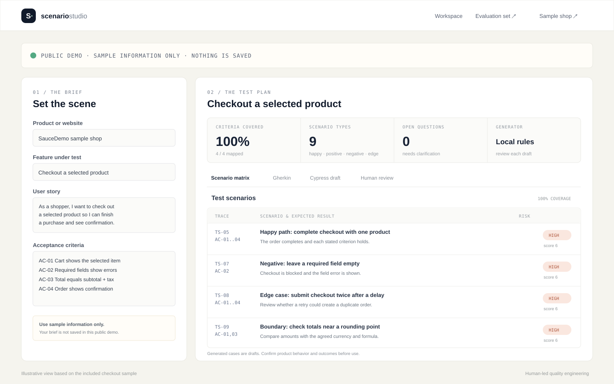

# AI QA Scenario Studio

This small demo turns a user story and acceptance criteria into a QA plan. It can suggest happy paths, positive checks, negative cases, and edge cases.

[](https://render.com/deploy?repo=https://github.com/nidaanjum89/ai-qa-scenario-studio)

## Sample output

This preview uses the included checkout sample. Your scenarios can be different.



The public demo uses local rules. It does not need an account or AI key, and it does not save the information you enter. Download the plan before you leave. Use sample information only.

## Run it on your computer

You need Python 3.10 or newer. No extra packages are needed.

1. Open a terminal in this folder.
2. Run `python3 app.py`.
3. Open <http://127.0.0.1:8000>.

The sample shop example is ready when the page opens.

## How to use it

1. Enter a user story and one acceptance criterion on each line.
2. Select **Generate QA artifacts**.
3. Review the scenario list, unclear questions, Gherkin, and Cypress draft.
4. Download the plan and code if you want to keep a copy.

The rules include examples for checkout, product search, forms, and the clothing-photo flow. These are suggestions based on the words in your brief. Read every case and correct it for the real product.

## About the Cypress draft

The Cypress output is a draft, not a ready-to-run test suite. Every generated test is skipped. Before using it, add the team's page objects or commands, selectors, test data, login setup, actions, and checks. Then review the test and enable it yourself.

The studio does not open the target website, find selectors, or run tests.

## Project memory on your computer

When you run the app on your own computer, it saves plans and reviews in a local project. You can back up the project or load a backup later. The public demo does not save project memory.

## Optional AI ideas

The app works without AI. If you add an OpenAI API key, the local app can request extra ideas. The current story and approved examples are sent to OpenAI for that request. Use sample information only; do not enter private, employer, customer, or confidential details.

## What this demo can and cannot tell you

- It shows how requirements can be turned into reviewable test ideas.
- It flags some unclear wording, but the simple rules can miss things.
- Its risk labels and scenario coverage do not prove that a product is safe or fully tested.
- The evaluation uses five sample briefs. It checks the app's rules, not real-world QA quality or AI accuracy.

To run the checks:

```bash
python3 -m unittest discover -s tests -v
python3 evaluate.py
```
